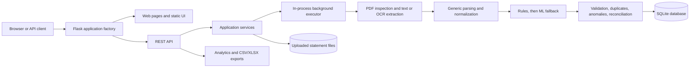

# Bank Statement Processing & Classification System

A Flask prototype built for the **Befree – AI & Automation Internship Programme Assessment** ("Bank Statement Processing & Classification System"). It imports bank statements (text-based or image-based PDFs), extracts account details and transaction data, classifies transactions **without any LLM**, checks statement consistency, and exports the results to **CSV or Excel**, through a browser UI or a REST API.

The processing path combines native PDF text extraction with configurable OCR, a shared heuristic parser, deterministic keyword rules, and a bundled scikit-learn classifier. It is an extraction and review tool: uncertain results are flagged rather than presented as guaranteed facts. **The application does not use a generative language model.**

**Author:** Rudra Rathod

## Contents

1. [Assessment alignment](#assessment-alignment)
2. [What it does](#what-it-does)
3. [Architecture](#architecture)
4. [Technology](#technology)
5. [Repository layout](#repository-layout)
6. [Setup and run (Windows PowerShell)](#setup-and-run-windows-powershell)
7. [OCR configuration](#ocr-configuration)
8. [Processing and classification details](#processing-and-classification-details)
9. [Web application](#web-application)
10. [REST API](#rest-api)
11. [CLI commands](#cli-commands)
12. [Production and security notes](#production-and-security-notes)
13. [Current boundaries](#current-boundaries)

---

## Assessment alignment

This section maps each requirement in the Befree assessment document to its implementation in this repository.

### Objective and problem statement

| Assessment requirement | How it is addressed |
|---|---|
| Fully functional prototype for processing bank statements in PDF format | Flask app with upload, background processing, review UI, REST API and export (see [Web application](#web-application)) |
| Handle both image-based and text-based PDFs | Per-page detection of text, scanned and mixed pages; native text via PyMuPDF/pdfplumber, OCR for pages without enough text (see [Extraction and normalization](#extraction-and-normalization)) |
| Extract account details and transaction data | Shared parser extracts statement metadata and transaction rows (see 3.2 below) |
| Classify by transaction description, **no LLM**, using heuristics or traditional ML | Keyword/regex rule engine first, then a bundled scikit-learn TF-IDF + logistic regression model (see [Classification](#classification)) |
| Export to Excel or CSV | `GET /api/export/{id}?format=csv` or `?format=xlsx`; UI download buttons on statement detail |
| Consider real-world scenarios, edge cases and usability | See [Edge cases and real-world scenarios](#edge-cases-and-real-world-scenarios) |

### 3.1 Input handling

| Requirement | Status | Implementation |
|---|---|---|
| Accept PDF bank statements from multiple banks | Met | Upload accepts PDF, JPG, JPEG and PNG (images are converted to PDF). Bank detection recognizes SBI, HDFC, ICICI, Axis, Bank of Baroda, Kotak Mahindra, UCO and Union Bank |
| Support text-based PDFs | Met | Native text extraction through PyMuPDF/pdfplumber |
| Support image-based PDFs | Met | OCR with PaddleOCR PP-StructureV3 (default), Tesseract, Azure Document Intelligence, Google Document AI or AWS Textract |
| Handle multiple formats and layouts across banks | Partially met | A single **generic** parser uses table headers and word coordinates, with text-row heuristics as a fallback. There are no dedicated per-bank parsers; rows that cannot be parsed are kept as unresolved rows |

### 3.2 Data extraction

| Field required by the assessment | Status | Notes |
|---|---|---|
| Account holder details: account number | Met | Extracted and stored masked |
| Account holder details: IFSC | Met | Extracted and validated (malformed IFSC is reported by validation) |
| Account holder details: other ("name, account number, IFSC, etc.") | Partially met | Bank name, branch, statement period and opening/closing balances are extracted when identifiable. **Account holder name extraction is not documented as implemented** |
| Transaction: Date | Met | Normalized from common date formats |
| Transaction: Description | Met | Includes continuation lines and UPI/NEFT/IMPS/cheque-style references |
| Transaction: Debit amount | Met | Debit/credit direction normalized |
| Transaction: Credit amount | Met | As above |
| Transaction: Balance | Met | Running balance captured and reconciled |

### 3.2 (second) Classification engine (non-LLM)

| Requirement | Status | Implementation |
|---|---|---|
| Heuristic rule-based approach | Met | Active exact, partial or regex keyword rules with priority, direction (debit/credit) awareness and user-defined rules, editable in the Categories & Rules page or via the API |
| Traditional machine learning model | Met | Bundled scikit-learn/joblib TF-IDF + logistic regression classifier with 20 category labels, applied to transactions not resolved by rules. Accuracy: 97.95% on seen data, 94.29% on unseen data (see [Model performance](#model-performance)) |
| Must not use an LLM | Met | No generative language model anywhere in the pipeline |

### 4. Output requirements

| Requirement | Status | Implementation |
|---|---|---|
| Export to Excel (.xlsx) | Met | Formatted five-sheet workbook (pandas/openpyxl) |
| Export to CSV (.csv) | Met | Text fields sanitized against spreadsheet formula injection |
| Include extracted transaction details | Met | Exports contain the statement's transactions, with the same filters as the transaction list (date range, category, method, review flag, amount range, search) |
| Include assigned category | Met | Each exported transaction carries its assigned category |

### 5. Key features

| Key feature | Where it lives |
|---|---|
| Upload and process bank statements | `/statements` page, `POST /api/statements/upload`, `POST /api/statements/{id}/process` |
| Auto-detect PDF type (text vs image) | `extraction/pdf_detector.py`; threshold settings `TEXT_MIN_CHARS_PER_PAGE` and `OCR_IMAGE_COVERAGE_THRESHOLD`; extraction method recorded per page |
| Accurate data extraction | Shared parser plus normalization, validation and balance reconciliation to expose extraction errors rather than hide them |
| Transaction classification without LLM | Rules, then ML fallback, with confidence-based review flags |
| Export to Excel/CSV | `export/csv_exporter.py`, `export/excel_exporter.py` |

### Edge cases and real-world scenarios

The assessment asks that edge cases and usability features be considered and implemented. Those present in the code:

| Scenario | Handling |
|---|---|
| Scanned, mixed or text pages in one PDF | Per-page type detection; extraction method and OCR warnings logged per page |
| Poor OCR quality | Optional secondary OCR provider run when primary output is weak; disagreements emit warnings (output is not auto-merged) |
| OCR provider failure | Automatic fallback provider (`OCR_FALLBACK_PROVIDER`, default Tesseract) |
| Corrupt, oversized, password-protected or very long files | Upload validation for size, file signature, readability, password protection and page limit |
| Unparseable rows | Preserved as unresolved rows and surfaced in the UI/API instead of being dropped |
| Multi-line descriptions | Continuation-line handling in normalization |
| Duplicate transactions | Exact and possible duplicates are flagged, never deleted |
| Missing or inconsistent data | Validation findings (missing dates/descriptions/amounts, debit and credit both set, negative amounts, missing balances, malformed IFSC, invalid period) |
| Extraction errors affecting totals | Reconciliation of opening balance + credits − debits against closing balance, plus running-balance checks |
| Suspicious activity | Anomaly flags for unusually large amounts, negative running balances and high daily counts (review flags, not fraud determinations) |
| Ambiguous or low-confidence classification | Marked for review; manual category changes are preserved on reclassification |
| Inter-account transfers distorting income/expense | Transfer categories are excluded from income/expense totals and reported separately |
| Spreadsheet formula injection in CSV | Text fields sanitized on export |
| Sensitive data | Masked account numbers, log redaction, CSRF protection and security headers |
| Usability | Drag-and-drop upload, progress polling, filtering, drawer for corrections, dashboard charts, light/dark theme, Swagger UI |
| Extensibility | Provider adapters for OCR, parser registry, user-defined categories and rules, standalone model training workflow |

### Known gaps against the assessment

- **Account holder name** is not listed among the extracted metadata fields.
- **Per-bank layouts** are handled by one generic parser, so accuracy on unusual layouts is not guaranteed; unresolved rows are the safety net.
- **Unresolved rows** can be inspected but not converted into transactions through the UI.
- **Production readiness**: no authentication/authorization, in-process (non-distributed) job executor, and SQLite storage by default (see [Production and security notes](#production-and-security-notes)).

---

## What it does

- Accepts PDF, JPG, JPEG, and PNG statement uploads. Images are converted to PDF for processing. Uploads are checked for size, signature, readability, and page limits. Password-protected PDFs prompt for a password; only a valid password unlocks and uploads the document. In the browser, each password applies to one PDF only; enter a separate password for each protected PDF.
- Detects text, scanned, and mixed pages and records the extraction method and OCR warnings for each page.
- Extracts statement metadata and transaction rows with a shared parser. It recognizes bank names for SBI, HDFC, ICICI, Axis, Bank of Baroda, Kotak Mahindra, UCO, and Union Bank, but parsing itself uses a generic parser rather than separate bank-specific implementations.
- Normalizes dates, amounts, debit/credit direction, descriptions, balances, and common payment references. Rows that cannot be parsed remain available as unresolved rows; ambiguous transactions are marked for review.
- Classifies transactions with active keyword rules first, then a bundled machine-learning model for transactions not resolved by rules. Manual category changes are preserved during ordinary reclassification.
- Checks transaction data, finds exact and possible duplicates, flags selected anomalies, and reconciles running and statement balances.
- Presents statements, transactions, categories, rules, review indicators, and financial summaries in a responsive web interface.
- Exports statement transactions as CSV or a formatted five-sheet Excel workbook. CSV text fields are sanitized against spreadsheet formula injection.

## Architecture



Statement processing is queued in the Flask application's thread executor. The worker updates status and progress as it extracts pages, parses and normalizes rows, classifies transactions, and runs validation. The browser polls the status endpoint while a job is queued or processing. Results are persisted in the database; uploaded source documents are stored separately on disk.

## Technology

- **Backend:** Python, Flask, Flask-SQLAlchemy, SQLAlchemy, Flask-Migrate, Flask-WTF, and SQLite by default.
- **Document processing:** PyMuPDF, pdfplumber, Pillow, OpenCV, and provider adapters for PaddleOCR PP-StructureV3, Tesseract, Azure Document Intelligence, Google Document AI, and AWS Textract.
- **Classification (non-LLM):** deterministic Python keyword rules and a bundled scikit-learn/joblib transaction classifier.
- **Browser UI:** Flask/Jinja templates, vanilla JavaScript ES modules, Bootstrap 5, Bootstrap Icons, and Chart.js. Bootstrap and Chart.js are loaded from jsDelivr; no frontend build tool or Node package manifest is present.
- **Exports and serving:** pandas/openpyxl for data and workbook support, with Waitress available as a WSGI server.

## Repository layout

```text
befree/
├── README.md
├── model/                         # Standalone classifier training and evaluation
│   ├── data/
│   │   └── bank_transaction_training_dataset.csv
│   ├── models/
│   │   └── transaction_classifier_v3.joblib
│   ├── reports/
│   │   ├── classification_report_v3.txt
│   │   ├── confusion_matrix_v3.png
│   │   └── unseen_prediction_test_v3.txt
│   ├── src/
│   │   ├── evaluate.py
│   │   ├── predict.py
│   │   ├── preprocessing.py
│   │   └── train.py
│   └── tests/
│       └── test_predictions.py
└── bankstatements/
    ├── wsgi.py                    # WSGI and local entry point
    ├── .env.example               # Configuration reference
    ├── requirements*.txt          # Core and provider-specific Python packages
    ├── app/
    │   ├── __init__.py            # create_app(), extension and route setup
    │   ├── config.py              # Development, testing, production settings
    │   ├── cli.py                 # Flask CLI utilities and default data seeding
    │   ├── errors.py              # JSON/HTML error handling
    │   ├── extensions.py          # Database, migrations, CSRF, executor
    │   ├── security.py            # Headers, filename helpers, log redaction
    │   ├── analytics/
    │   │   └── financial_analytics.py
    │   ├── api/                   # analytics, categories, classification, classify,
    │   │                           # docs, export, health, statements, transactions, validation
    │   ├── classification/        # confidence, feature_extractor, ml_classifier,
    │   │                           # rule_engine, seed_catalog
    │   ├── data/                  # classification_rules.csv and transaction_classifier_v3.joblib
    │   ├── export/                # csv_exporter.py and excel_exporter.py
    │   ├── extraction/            # bank_detector, bank_parser, document_ocr,
    │   │                           # ocr_extractor, pdf_detector, table_extractor,
    │   │                           # text_extractor, transaction_normalizer
    │   │   └── parsers/           # generic.py and registry.py
    │   ├── models/                # category, classification_rule, processing_log,
    │   │                           # statement, transaction, types, unresolved_row,
    │   │                           # validation_result
    │   ├── schemas/               # Package placeholder; no schema implementation
    │   ├── services/              # category, pretrained_classifier, processing,
    │   │                           # statement, transaction, and upload services
    │   └── web/
    │       ├── routes.py
    │       ├── filters.py
    │       ├── templates/         # base, dashboard, statements, statement_detail,
    │       │                       # transactions, categories, and error pages
    │       └── static/
    │           ├── css/app.css
    │           └── js/             # api, categories, charts, dates, money, statements,
    │                               # statement_detail, transactions, upload
    ├── tests/
    │   └── test_document_extraction.py
    ├── test_uploads/              # Test statement fixtures
    ├── instance/                  # Runtime SQLite database and instance files
    └── uploads/                   # Runtime uploaded statement files
```

`instance/` and `uploads/` are data locations, not application source. The application factory creates the instance and upload directories when needed. `model/` contains the separate standalone model-development workflow and its training dataset, model, reports, and tests. The Flask application loads `bankstatements/app/data/transaction_classifier_v3.joblib` and its seed rules from `bankstatements/app/data/classification_rules.csv`.

### Trained classifier artifacts

There are two distinct classifier files in the repository:

- **Standalone trained artifact:** [`model/models/transaction_classifier_v3.joblib`](model/models/transaction_classifier_v3.joblib) is produced by `model/src/train.py` using `model/data/bank_transaction_training_dataset.csv`. It is a scikit-learn pipeline with a unigram TF-IDF vectorizer and logistic regression. Preprocessing drops rows missing a description or category, removes duplicate descriptions, lowercases and normalizes whitespace, then makes a stratified 80/20 train/test split (random state `42`). `model/src/predict.py` loads this artifact and returns predicted labels with their predicted-class probabilities.
- **Flask runtime artifact:** [`bankstatements/app/data/transaction_classifier_v3.joblib`](bankstatements/app/data/transaction_classifier_v3.joblib) is the separately packaged artifact that the Flask app loads by default. The runtime loader verifies this file against the configured SHA-256 checksum and validates its expected pipeline steps and 20 category labels. The standalone model file and Flask runtime artifact have different SHA-256 hashes in the current checkout; training the standalone artifact does not automatically replace the Flask model.

The existing evaluation output is stored under `model/reports/`: the classification report, confusion-matrix image, and unseen-prediction test report. These are generated artifacts for the checked-in model/data.

### Model performance

Measured on the standalone classifier (`model/models/transaction_classifier_v3.joblib`):

| Evaluation | Accuracy | Source |
|---|---:|---|
| Seen data (held-out test split of the training dataset) | **97.95%** | `model/reports/classification_report_v3.txt` |
| Unseen data (transactions not in the training dataset) | **94.29%** | `model/reports/unseen_prediction_test_v3.txt` |

Notes on interpreting these figures:

- The unseen-data figure is the better indicator of real-world behavior; the gap between the two shows some drop-off on descriptions the model has not encountered.
- Both figures are for the standalone model and its checked-in dataset. The Flask runtime artifact is packaged separately (different SHA-256 hash), so these numbers are not guaranteed to carry over to it unchanged.
- Accuracy on the classifier covers category assignment only. It says nothing about extraction accuracy on real statements, and it is not a guarantee on new statements; low-confidence results are still flagged for review.

## Setup and run (Windows PowerShell)

Run these commands from the repository root:

```powershell
Set-Location .\bankstatements
py -3 -m venv .venv
.\.venv\Scripts\Activate.ps1
python -m pip install --upgrade pip
python -m pip install -r requirements.txt
python -m pip install Flask-Executor
```

`Flask-Executor` is imported by `app/extensions.py` but is not listed in the checked-in `requirements.txt`; install it explicitly as shown above.

The configured OCR provider defaults to PaddleOCR. Install its provider dependencies to process scanned (image-based) pages with the default provider:

```powershell
python -m pip install -r requirements-ocr-paddle.txt
```

The PaddleOCR setup may download model files on first use. Alternatively, select Tesseract and install its system executable separately; `pytesseract` in the Python requirements is only a wrapper around that executable. Azure, Google, and AWS providers each have a separate requirements file and require provider credentials/configuration (see [OCR configuration](#ocr-configuration)).

Start the development server from `bankstatements/`:

```powershell
python -m flask --app wsgi run --host 127.0.0.1 --port 5000
```

Open [http://127.0.0.1:5000](http://127.0.0.1:5000). The default configuration is development. On application startup, missing database tables are created and default categories/rules are seeded. The default database path is `bankstatements/instance/bankstatements.db`; the upload directory defaults to `bankstatements/uploads/`.

No `.env` file is required for local development. Use environment variables or a local `.env` file for overrides. If copying `.env.example`, check its `DATABASE_URL` value against the desired Flask-SQLAlchemy instance-relative database path; the code default already points to `instance/bankstatements.db`.

### Quick walkthrough of the assessment flow

1. Start the server and open the **Statements** page.
2. Upload a text-based PDF and an image-based/scanned PDF (fixtures are in `bankstatements/test_uploads/`; `generate-samples` can create synthetic ones).
3. Process the statement and watch the status/progress; open the statement detail page to see the per-page extraction method (text, scanned or mixed).
4. Review extracted metadata, transactions, assigned categories, unresolved rows and validation warnings.
5. Download the result as **CSV** or **XLSX** from the statement detail page.

### Tests and model workflow

To run the focused Python test suite:

```powershell
python -m pytest
```

The standalone classifier tests can also be run from the repository root:

```powershell
python -m pytest .\model\tests\test_predictions.py
```

Train or evaluate the standalone model from the repository root:

```powershell
python .\model\src\train.py
python .\model\src\evaluate.py
```

Training requires pandas, scikit-learn, and joblib. Evaluation additionally imports Matplotlib and Seaborn. The model scripts do not have a dedicated requirements file in this checkout; the application requirements provide the training packages, but not necessarily the plotting packages used by evaluation.

## OCR configuration

The base [requirements.txt](bankstatements/requirements.txt) includes the Tesseract Python wrapper and PDF/image libraries, but not every OCR engine or its system dependencies. Provider-specific files are:

| Provider | Install | Configuration |
|---|---|---|
| PaddleOCR PP-StructureV3 (default) | `requirements-ocr-paddle.txt` | `OCR_PROVIDER=paddleocr`; `OCR_USE_GPU=false` by default |
| Tesseract | Core requirements plus the Tesseract executable on `PATH` | `OCR_PROVIDER=tesseract` |

`OCR_FALLBACK_PROVIDER` defaults to `tesseract`; the fallback is attempted when the primary provider raises an OCR-provider error. Tesseract must therefore be installed if it is to be used as a fallback. `OCR_SECONDARY_PROVIDER` is an optional independent verification provider, run only when primary OCR output is weak. When configured, cloud OCR providers receive page images for processing; use provider credentials and data-handling settings appropriate for the statements being processed.

Useful OCR and document settings (defaults are from `app/config.py` and `.env.example`):

| Setting | Default | Purpose |
|---|---:|---|
| `MAX_UPLOAD_MB` | `50` | Per-file validation limit and configured request size limit |
| `MAX_DOCUMENT_PAGES` | `500` | Maximum accepted PDF page count |
| `OCR_DPI` | `300` | Resolution used to render pages for OCR |
| `TEXT_MIN_CHARS_PER_PAGE` | `50` | Native-text threshold for page-type detection |
| `OCR_IMAGE_COVERAGE_THRESHOLD` | `0.20` | Image coverage threshold for mixed-page detection |
| `OCR_PROVIDER` | `paddleocr` | Primary scanned-page OCR provider |
| `OCR_FALLBACK_PROVIDER` | `tesseract` | Provider tried after primary OCR failure |
| `CONFIDENCE_THRESHOLD` | `0.6` | Rule classification confidence threshold |
| `PRETRAINED_TRANSACTION_CONFIDENCE_THRESHOLD` | `0.30` | ML prediction threshold below which review is required |
| `RECONCILIATION_TOLERANCE` | `0.50` | Balance reconciliation tolerance |
| `FILE_RETENTION_DAYS` | `90` | Age used by the manual upload-cleanup CLI command |

Other environment settings, including Paddle model names, model path/checksum, `DATABASE_URL`, `UPLOAD_DIR`, `SECRET_KEY`, and `LOG_LEVEL`, are defined in `app/config.py` and `.env.example`. The `DATABASE_URL` sample in `.env.example` is an example override; the code default is the `instance/bankstatements.db` file described above.

## Processing and classification details

### Extraction and normalization

PyMuPDF inspects each page and extracts native text where available. Pages with insufficient text are rendered for OCR; pages with both readable text and substantial image coverage are treated as mixed. OCR adapters return text, positioned words, and detected tables in a common representation. Optional secondary OCR compares results and emits warnings on disagreement; the output is not automatically merged when providers disagree.

The parser registry currently exposes one shared generic parser. It uses table headers and word coordinates when possible, with text-row heuristics for other layouts. Statement metadata includes bank name, masked account number, IFSC, branch, period, and opening/closing balances when identifiable. Transaction normalization handles common date and amount formats, continuation lines, and UPI/NEFT/IMPS/cheque-style references. Extracted monetary values are represented as `Decimal`; database monetary values are stored as integer paise and returned as two-decimal amounts.

### Classification

1. Active exact, partial, or regular-expression rules are evaluated first (**heuristic rule-based approach**). Direction-aware rules may target debit or credit transactions. A higher priority wins; ties prefer longer keywords and then user-defined rules.
2. Transactions not resolved by a rule are sent to the bundled classifier (**traditional machine-learning approach**). Its 20 supported labels are: Food & Dining, Shopping, Transport, Utilities, Entertainment, Salary, Freelance / Business Income, Rent, Investment, Cash Withdrawal, Bank Charges, Credit Card Payment, Cashback / Rewards, Healthcare, Insurance, Fitness, Interest Income, Charity/Donation, Transfer, and Other.
3. Missing, unresolved, or low-confidence results are marked for review. Manual category overrides are retained unless a caller explicitly requests forced reclassification.

The bundled model is loaded lazily and its SHA-256 checksum and expected pipeline/category set are verified before inference. The separate `train-model` CLI utility can train a TF-IDF/tabular-feature scikit-learn model from labeled CSV data; it writes a separate artifact and is not the runtime loader for the bundled classifier.

## Web application

The browser UI is served by Flask and includes:

- **Dashboard (`/`)**: income, expenses, net cash flow, transfers, unclassified/review count, recent processed transactions, and category/monthly/debit-credit/daily charts.
- **Statements (`/statements`)**: drag-and-drop or file-picker uploads, optional upload-and-process, status filtering, pagination, processing, and deletion.
- **Statement detail (`/statements/<id>`)**: extracted account and balance overview, per-page extraction log, progress/status polling, transaction filtering and reclassification, unresolved-row review, and CSV/XLSX download.
- **Transactions (`/transactions`)**: paginated search/filter/sort and a detail drawer for extraction metadata, validation warnings, anomaly flags, notes, and category corrections.
- **API reference (`/docs`)**: interactive Swagger UI for the OpenAPI specification.

All pages share a light/dark theme toggle that persists the selected theme in browser local storage. The UI uses the same REST API as external clients. Mutating requests are protected by Flask-WTF CSRF; the included JavaScript reads the page token and sends it in the `X-CSRFToken` header.

## REST API

All API routes are under `/api`. UUID path parameters are shown as `{id}` below.

| Method and path | Purpose |
|---|---|
| `GET /api/health` | Basic service health response |
| `POST /api/statements/upload` | Upload one or more files using multipart field `files`; include `password` when retrying a protected PDF |
| `GET /api/statements` | Paginated statement list; optional `processing_status` filter |
| `GET /api/statements/{id}` | Statement details |
| `POST /api/statements/{id}/process` | Queue statement processing (`202` response) |
| `GET /api/statements/{id}/status` | Processing state, progress, page counts, and current step |
| `DELETE /api/statements/{id}` | Delete statement records and stored source file |
| `GET /api/statements/{id}/transactions` | Paginated, filterable transactions for a statement |
| `GET /api/statements/{id}/unresolved` | Rows that could not be parsed into transactions |
| `GET /api/transactions` | Paginated, filterable transactions across statements |
| `GET /api/transactions/{id}` | Transaction detail |
| `PATCH /api/transactions/{id}` | Set category, review state, or notes |
| `POST /api/classification/classify` | Reclassify transactions for a stored statement; optional `force` |
| `POST /api/classify` | Stateless classification of one supplied transaction |
| `POST /api/classify/bulk` | Stateless classification of up to 500 transactions |
| `GET /api/classify/categories` | Exact classifier label set |
| `GET /api/classify/status` | Bundled model artifact/load status |
| `GET /api/categories` / `POST /api/categories` | List or create categories |
| `PATCH /api/categories/{id}` | Update category |
| `GET /api/categories/rules` / `POST /api/categories/rules` | List or create rules; listing accepts `category_id` |
| `PATCH /api/categories/rules/{rule_id}` / `DELETE /api/categories/rules/{rule_id}` | Update or delete a user-defined rule |
| `GET /api/analytics` | Aggregate analytics across successfully processed statements |
| `GET /api/analytics/{id}` | Analytics for one statement |
| `GET /api/dashboard/recent-transactions` | Recent transactions from successfully processed statements |
| `GET /api/export/{id}?format=csv` or `?format=xlsx` | Download a filtered transaction export (**assessment output requirement**) |
| `GET /api/openapi.json` | OpenAPI 3.0.3 document used by Swagger UI |

Transaction list and export endpoints support applicable filters for date range, category, classification method, validation status, duplicate status, review flag, amount range, text search, sorting, and pagination. List page sizes default to 50 and are capped at 200; export requests retrieve up to 10,000 rows. The stateless classifier limits descriptions to 4,000 characters.

Example read-only request:

```powershell
curl.exe http://127.0.0.1:5000/api/health
```

An upload request uses multipart form data, for example `files=@C:\path\to\statement.pdf`. A protected PDF first returns a `PDF_PASSWORD_PROTECTED` per-file error; retry the same file with its password in the multipart `password` field. For multiple protected PDFs, provide each file's password separately; the browser prompts one PDF at a time and does not reuse passwords between files. An incorrect password returns `PDF_INVALID_PASSWORD`. The application does not store the password and saves an unlocked copy only after authentication succeeds. For direct API POST/PATCH requests, obtain a CSRF token from the web page and send it as `X-CSRFToken` with the same session. API errors use a JSON envelope of the form `{"error":{"code":"...","message":"..."}}`.

## CLI commands

Run from `bankstatements/` after activating the virtual environment:

```powershell
python -m flask --app wsgi init-db
python -m flask --app wsgi seed
python -m flask --app wsgi check-deps
python -m flask --app wsgi cleanup-uploads
python -m flask --app wsgi generate-samples --output-dir .\instance\samples
```

- `init-db` creates missing tables. The app factory also creates tables on startup.
- `seed` idempotently seeds built-in categories and classification rules from the CSV catalog; the app factory also seeds outside testing mode.
- `check-deps` checks selected Python packages and system OCR tools/providers.
- `cleanup-uploads` removes old files from the configured upload directory. It does not remove corresponding statement metadata from the database.
- `generate-samples` writes synthetic statement PDFs for exercising extraction scenarios.
- `train-model --csv <file> [--output <file>]` trains the separate model utility. The CSV must contain `description` and `category_name`; `debit` and `credit` are optional.

For example:

```powershell
python -m flask --app wsgi train-model --csv .\training.csv --output .\models\classifier.pkl
```

## Production and security notes

For a local Waitress deployment, set production configuration and a strong secret before starting the server:

```powershell
$env:FLASK_CONFIG = "production"
$env:SECRET_KEY = (python -c "import secrets; print(secrets.token_hex(32))")
waitress-serve --host=127.0.0.1 --port=5000 wsgi:app
```

Production configuration rejects the development secret. Upload validation, CSRF protection, security response headers, masked account numbers, and log redaction are implemented. The application does **not** implement user authentication or authorization, and its default SQLite/file storage is local; do not expose it to untrusted networks without adding appropriate access controls and deployment-specific protections. Cloud OCR is optional but sends page images to the selected provider.

## Current boundaries

- Statement parsing is handled by one generic parser; bank-name recognition does not mean there are dedicated format parsers for each bank.
- Account holder name is not among the documented extracted metadata fields.
- Background processing uses an in-process executor rather than a distributed job queue.
- File retention is exposed as a manual CLI operation, not a scheduled cleanup task.
- Unresolved rows can be inspected in the UI, but the code does not provide an editing workflow to turn an unresolved row into a transaction.
- No roadmap or future feature commitments are defined here; the boundaries above describe only what is not implemented in the current code.
